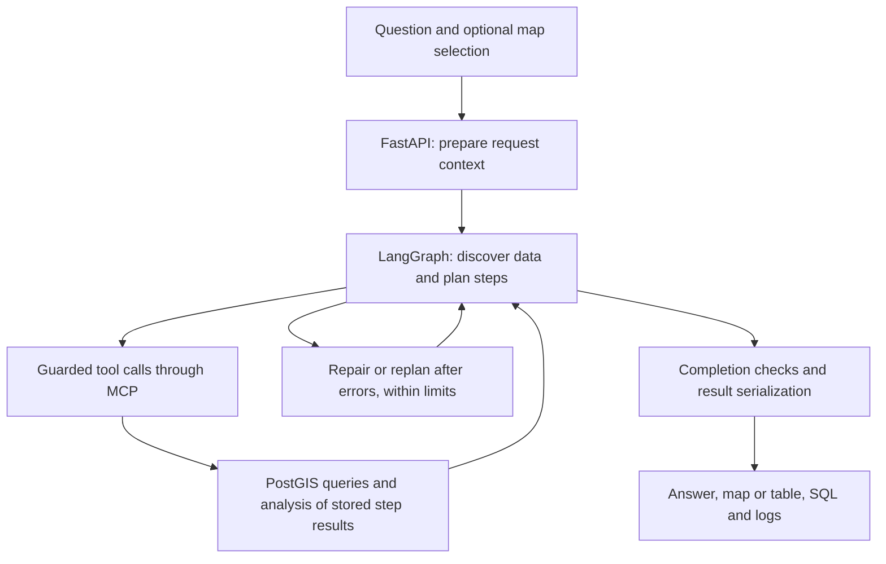

# Natural-language GIS analysis with LLM agents

This master's project turns natural-language questions into geographic analyses over Norwegian building, property, administrative, and hazard datasets. A language-model agent discovers the available data, plans the analysis, validates SQL, and uses tools to execute it. The interface presents the answer alongside a map or table and the steps that produced it.

## Watch the prototype

**[Watch the master's project demo](https://drive.google.com/file/d/1PzHlpxn4E91q0KO5v49n1uM23W8GC5mV/view?usp=sharing)**

The video shows the prototype from the master's project. Full execution requires model access and external geographic data that are not included here; the video and code provide a way to review the project without those services.

## Follow a question through the system

> Count all buildings in Drammen municipality that intersect 200-year flood zones.

This is benchmark task B14 in [pipeline_runner.py](backend/evaluation/pipeline_runner.py). It requires finding building and flood-zone data, applying the geographic and return-period constraints, and counting the buildings that satisfy the spatial relation.

LangGraph keeps the plan and execution state across model/tool turns. MCP connects those turns to concrete database and analysis tools. PostgreSQL/PostGIS serves the geographic data; memory and DuckDB retain intermediate results for later steps. The [architecture guide](docs/architecture.md) explains each component's role and follows the actual functions involved.

## Repository map

| Location | Purpose |
| --- | --- |
| [frontend/src/app/](frontend/src/app/) | Question entry, model selection, map/table views, and execution inspection. |
| [backend/app.py](backend/app.py) | FastAPI entry point and response conversion. |
| [backend/evaluation/](backend/evaluation/) | Shared interactive/batch agent, state, prompts, benchmark runner, and reporting. |
| [backend/tools/](backend/tools/) | Model-facing tool wrappers. |
| [backend/mcp/](backend/mcp/) | MCP client, server registrations, database discovery, analysis tools, and intermediate results. |
| [backend/database/](backend/database/) | PostgreSQL connection pools and read-only query execution. |
| [backend/embeddings/](backend/embeddings/) | Optional metadata index for finding candidate databases. |
| [backend/storage/](backend/storage/) | Cloud persistence of evaluation runs. |
| [docs/](docs/) | Architecture, evaluation findings, and runtime context. |

## Recommended reading order

1. **Follow the request:** `sendToBackend()` in [page.tsx](frontend/src/app/page.tsx), then `run_query()` in [app.py](backend/app.py). See how the question, selected models, and map context enter the backend.
2. **Understand the agent:** `agent()` in [pipeline_runner.py](backend/evaluation/pipeline_runner.py), `AgentState` in [agent_models.py](backend/evaluation/agent_models.py), and `_build_agent_graph()` in [agent_graph.py](backend/evaluation/agent_graph.py). These connect initialization, state, and control flow.
3. **Trace one tool call:** `_tools_node()` in [agent_tools_node.py](backend/evaluation/agent_tools_node.py), the [model-facing wrappers](backend/tools/langchain_tools.py), and `execute_query_step()` in [step_tools.py](backend/mcp/server/step_tools.py). Follow the [MCP walkthrough](docs/architecture.md#mcp-the-tool-call-path) for the intervening client/server calls.
4. **Follow dependent steps:** `_save_rows()` / `_get_rows()` in [step_storage.py](backend/mcp/server/step_storage.py) and `execute_spatial_join_step()` in [step_tools.py](backend/mcp/server/step_tools.py). These explain how results from separate sources become one analysis.
5. **Inspect evaluation evidence:** `main()` in [pipeline_runner.py](backend/evaluation/pipeline_runner.py) selects tasks/models; `store_run()` in [reporting.py](backend/evaluation/reporting.py) records the results. The [evaluation guide](docs/evaluation.md) separates execution diagnostics from the thesis's reference-answer assessment and reported findings.

The project develops an agent system and evaluates pretrained models, rather than training new models. A central finding is that completing the workflow does not guarantee a correct spatial answer; the [evaluation guide](docs/evaluation.md#technical-completion-was-not-semantic-correctness) gives the documented example and its thesis reference.

For interface details, see the [frontend guide](frontend/README.md). For dependencies and retained development configuration, see the [runtime notes](docs/runtime-context.md). This research prototype was reviewed through source and documentation; the full system was not rerun for this update.
