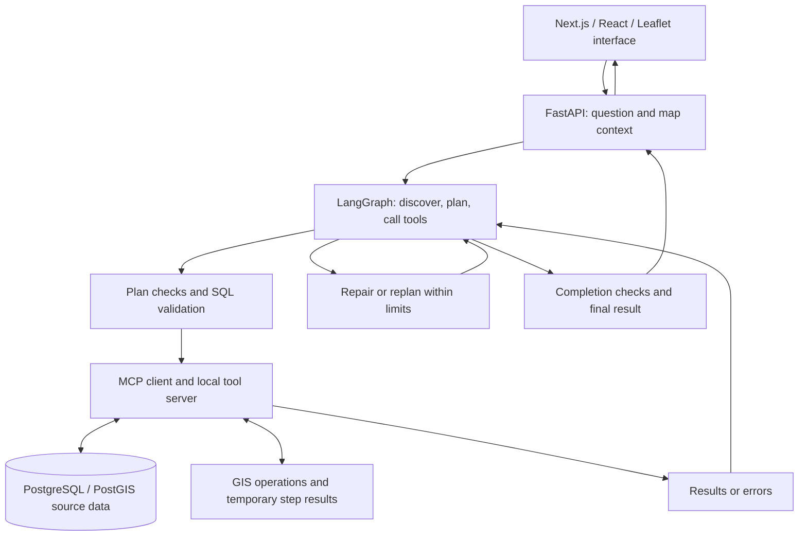

# Natural-language GIS analysis with LLM agents

Geographic questions often require finding the right datasets, writing spatial queries, and combining results across several sources. This master's project explores how language models can carry out that workflow through a controlled GIS agent, with a map-based interface and detailed execution traces.

Developed jointly by **Matin Mohammadi and Sander Gnanavel** as part of the master's degree in **Artificial Intelligence and the Internet of Things at the University of Agder**, in collaboration with **Norkart**. The work combines agent-system development with systematic evaluation of pretrained language models; it does not train new models.

## Watch the prototype

**[Watch the master's project demo on Google Drive](https://drive.google.com/file/d/1PzHlpxn4E91q0KO5v49n1uM23W8GC5mV/view?usp=sharing)**

The video shows the prototype from the master's project. It is the main demonstration for reviewers. Full execution requires external model access and geographic databases that are not supplied with this repository; the original access is no longer available. Review the video, code, and documentation without setting up those services.

## What the agent does

An example from the existing benchmark is:

> Count all buildings in Drammen municipality that intersect 200-year flood zones.

This is task B14 in [pipeline_runner.py](backend/evaluation/pipeline_runner.py). It illustrates the need to identify building and flood-zone data, apply the municipality and flood-return-period constraints, perform the spatial comparison, and count the result. It is a benchmark question, not a claim about a particular demo result.

The application sends the question and optional map context to FastAPI. A LangGraph agent discovers schemas, builds a numbered plan, validates SQL, and calls MCP tools to retrieve and combine data. Results return as an answer and, where applicable, a map or table. The interface also exposes SQL, steps, and errors for inspection.

MCP provides the tool-call boundary. PostGIS holds the source datasets; intermediate results stay in memory or temporary DuckDB storage. Validation and recovery help enforce the workflow, but successful execution alone does not prove that an answer is correct. See the [architecture walkthrough](docs/architecture.md).

## What the evaluation found

The thesis evaluates **13 models on 30 GIS tasks across five difficulty levels**. Its final statistical analysis uses the shared **prompt v5 without embedding retrieval**, retaining up to **20 runs per model–task pair**. These are report findings, not results regenerated from this checkout.

- **The system could solve repeatable spatial tasks.** Gemma 4 achieved exact reference matches in all 20 runs on 17 tasks, including simple lookups and several spatial-filtering tasks. This was the strongest configuration in the reported final comparison, not a general ranking of language models. *(Thesis §5.9, pp. 85–86.)*
- **A completed workflow could still be wrong.** Of Gemma's 600 retained runs, 467 completed: 360 matched the reference exactly, 25 received partial credit, and 82 completed with an incorrect result. *(Table 5.8 and §5.9, p. 85.)*
- **Finding data was only the first step.** Retrieval reduced discovery effort, but did not consistently improve final correctness. Wrong spatial predicates, guessed category codes, and missing deduplication remained important failure modes. *(§5.6 and §5.8.2.)*

The [evaluation guide](docs/evaluation.md) explains the method, source references, limitations, and the difference between the thesis experiments and the evaluation code here. The report PDF and its result files are not bundled in this repository. The thesis also identifies [separate supplementary repositories](docs/evaluation.md#sources-and-supplementary-material).

## Read the code

| Start here | What to look for |
| --- | --- |
| [Agent graph](backend/evaluation/agent_graph.py) and [tool node](backend/evaluation/agent_tools_node.py) | Planning, state transitions, validation guards, repair, and replanning. |
| [Model-facing tools](backend/tools/langchain_tools.py) and [MCP step tools](backend/mcp/server/step_tools.py) | Tool schemas, SQL execution, spatial joins, filtering, aggregation, and ranking. |
| [Discovery and validation](backend/mcp/server/discovery_tools.py), [database registry](backend/mcp/server/registry.py), and [connection pools](backend/database/database.py) | Schema grounding, SQL checks, source database selection, and read-only queries. |
| [Evaluation runner](backend/evaluation/pipeline_runner.py) and [reporting](backend/evaluation/reporting.py) | Benchmark questions, selected models, run parameters, traces, and outcome diagnostics. |
| [API](backend/app.py) and [frontend guide](frontend/README.md) | Request handling, result serialization, map/table display, and inspection panels. |

## Scope and runtime context

This is a research prototype, not a production-ready GIS service. The findings concern the tested tasks, datasets, prompts, models, and execution constraints. The [runtime notes](docs/runtime-context.md) explain dependencies, entry points, and retained historical configuration without presenting them as a complete public setup recipe.

Documentation was checked against source commit `b051f44ecd4c8037fb8fbabbec0b3c230f5ec14a` and the supplied 2026 thesis. The full system was not rerun for this documentation update.
